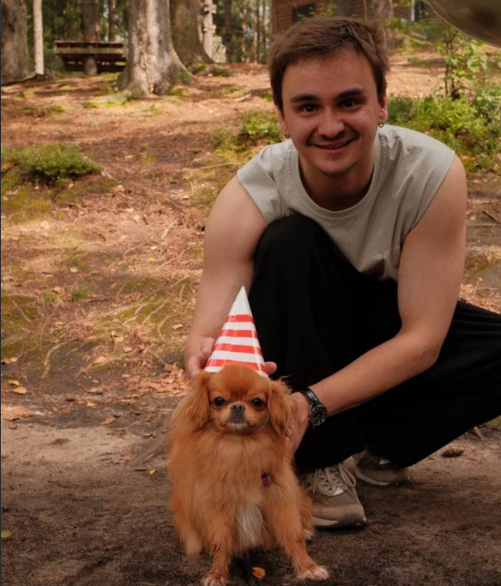

# Немного обо мне

Привет! Меня зовут Николай.

Мне 31 год. Люблю разбираться в новых вещах, пробовать что-то интересное и доводить начатое до результата.

Сейчас изучаю IT, в частности тестирование программного обеспечения, HTML, CSS и JS, хочу наработать отличную базу.

## Чем занимаюсь

- Изучаю программирование и тестирование.
- Разбираюсь в работе нейросетей и автоматизации.
- Создаю небольшие приложения и Telegram-ботов.
- Регулярно занимаюсь спортом.
- Люблю готовить, экспериментировать с рецептами и кофе.

## Что использую в работе

- Python
- JavaScript
- HTML / CSS
- Git и GitHub
- PyCharm
- VS Code

## Мои проекты

Пока проектов не так много, но есть несколько собственных разработок, над которыми я работаю:

- **Бот в тг**
- **Создание сайтов и веб приложений с поиощью нейросетей**
- **Попытки автоматизации и создания агентов через Docker**

## Планы

Хочу получить хорошую базу в IT, научиться самостоятельно разрабатывать приложения и разобраться в технологиях, с которыми работаю.

В общем, учусь, пробую и постепенно набираюсь опыта.

